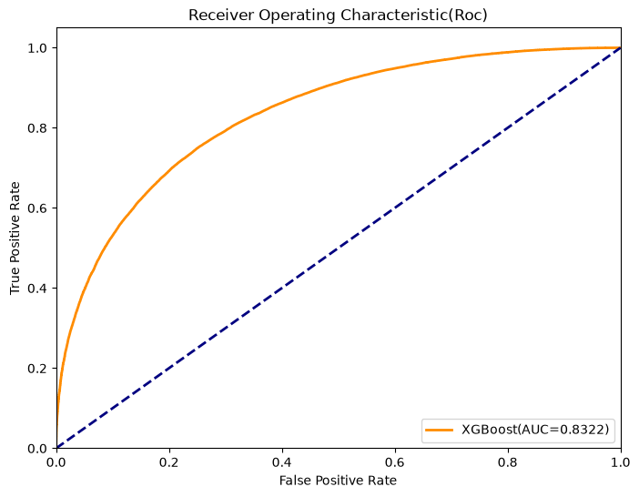

# XGBoost Paper Replication

Replication study of "XGBoost: A Scalable Tree Boosting System" for the MIAE01 course project.

## 1. Project Overview

This project aims to reproduce selected experiments from the original XGBoost paper.

The main focus is the classification experiment in the original paper. We plan to compare XGBoost with a scikit-learn baseline and analyze their classification performance and training efficiency.

## 2. Original Paper

**Title:** XGBoost: A Scalable Tree Boosting System

**Authors:** Tianqi Chen and Carlos Guestrin

**Conference:** KDD 2016

**Paper:** https://arxiv.org/abs/1603.02754

## 3. Starting Code

**Official XGBoost Repository:**
https://github.com/dmlc/xgboost

**Scikit-learn Repository:**
https://github.com/scikit-learn/scikit-learn

The project uses existing machine learning
libraries and develops its own Python scripts
for dataset preparation, model training,
result validation and analysis.

The exact installed library versions,
corresponding upstream source revisions
where applicable, and license information
will be documented before final submission.

## 4. Reproduction Scope

The project focuses on the classification
experiment in Section 6.3 and Table 3 of
the original XGBoost paper.

### Main Reproduction

- Dataset: Higgs-1M
- Task: Binary classification
- Models: XGBoost and scikit-learn
- Number of trees: 500
- Maximum tree depth: 8
- Learning rate: 0.1
- Main metric: Test AUC
- Efficiency metric: Time per Tree

We aim to investigate whether XGBoost can
achieve comparable classification accuracy
while offering higher training efficiency.

### Statistical Evaluation

We plan to use three random seeds:
42, 123 and 2026.

Results will be reported using the mean
and standard deviation across repeated runs.

### Extension

An additional experiment will investigate
the effect of maximum tree depth on
classification performance and training time.

For the detailed experimental protocol, see
[Replication Plan](docs/replication_plan.md).

## 5. Repository Structure

```text
xgboost-paper-replication/
├── .gitignore
├── README.md
├── requirements.txt
├── docs/
│   ├── paper_notes.md
│   ├── replication_plan.md
│   ├── results_analysis_plan.md
│   └── preliminary_results_analysis.md
├── logs/
│   ├── higgs_xgb_seed42.log
│   ├── higgs_xgb_seed123.log
│   ├── higgs_xgb_seed2026.log
│   ├── higgs_sklearn_seed42.log
│   ├── higgs_sklearn_seed123.log
│   └── higgs_sklearn_seed2026.log
├── results/
│   ├── higgs_xgb_seed42.csv
│   ├── higgs_xgb_seed123.csv
│   ├── higgs_xgb_seed2026.csv
│   ├── higgs_xgb_seed42_curve.csv
│   ├── higgs_xgb_seed123_curve.csv
│   ├── higgs_xgb_seed2026_curve.csv
│   ├── roc_curve_seed42.png
│   ├── roc_curve_seed123.png
│   ├── roc_curve_seed2026.png
│   ├── raw/
│   │   ├── experiment_results_template.csv
│   │   └── xgb_preliminary_seed_results.csv
│   ├── summary/
│   │   └── model_summary.csv
│   └── figures/
│       ├── test_auc_by_seed.png
│       └── training_time_per_tree_by_seed.png
└── scripts/
    ├── download_higgs.py
    ├── train_higgs.py
    ├── validate_results.py
    ├── sync_analysis_data.py
    ├── analyze_results.py
    ├── plot_results.py
    └── train_sklearn_histgb.py
```

### Directory Description

- `docs/`: Paper analysis and experimental design.
- `scripts/`: Dataset preparation, model training,
  result validation and statistical analysis.

- `logs/`: Detailed training logs.
- `results/`: Experimental metrics, AUC curves,
  ROC visualizations and statistical outputs.
- `requirements.txt`: Python package dependencies.
- `README.md`: Project overview and instructions.
- `results/raw/`: Raw analysis input records.
- `results/summary/`: Aggregated statistical results.
- `results/figures/`: Experimental visualizations.

The `data/` directory is generated locally
and excluded from GitHub.

Experimental results and training logs are
committed for reproducibility and analysis.

The preliminary statistical analysis scripts
and figures are included in this repository.

They process the committed experimental
outputs without independently rerunning
model training.

## 6. Environment and Reproducibility

The project uses Python and existing
machine learning libraries.

Main dependencies include:

- XGBoost
- scikit-learn
- pandas
- NumPy
- matplotlib

### Dataset Preparation

The dataset is obtained from the
UCI HIGGS dataset repository.

The existing download script can be invoked
from the project root directory:

```bash
python scripts/download_higgs.py
```

The script is designed to extract
1,000,000 samples and save them to:

`data/HIGGS_1M.csv`

The current extraction method selects the
first 1,000,000 rows of the original HIGGS
dataset rather than a randomly sampled subset.

This difference from the original paper
is documented in the replication plan.

The downloaded dataset should not be
committed to GitHub because of its size.

### Training Environment

The XGBoost training implementation uses
all 28 input features and supports a
multi-seed experiment loop.

The current XGBoost configuration includes:

- Training/validation/test split: 70/15/15
- Number of boosting rounds: 500
- Maximum tree depth: 8
- Learning rate: 0.1
- Random seeds: 42, 123, 2026
- Evaluation metric: AUC
- CPU threads: Not explicitly configured
- Tree method: Not explicitly configured

A scikit-learn baseline script has also
been added using HistGradientBoostingClassifier.

It uses 500 boosting iterations, maximum
depth 8, learning rate 0.1 and the same
three random seeds.

This baseline is a modern histogram-based
implementation and is not an exact
reproduction of the original paper's
scikit-learn benchmark.

Preliminary baseline logs are available,
but the corresponding result CSV files
have not yet been committed.

The dependency file, CPU configuration,
tree construction method and complete
environment information require further
verification before reliable comparisons
can be made.

### Result Validation

The existing experimental outputs can be
checked using:

```bash
python scripts/validate_results.py
```

The validation script checks:

- Required result files and training logs
- Random seed consistency
- Number of boosting rounds
- Validity of AUC and timing values
- Completeness of training and validation curves
- Consistency between CSV files and logs

The validation does not require the
original HIGGS dataset.

Passing these checks confirms file-level
consistency but does not replace
independent experimental reruns.

A validation performed on November 26, 2026
reported training-time inconsistencies
for all three XGBoost seeds.

The result was 0/3 PASS.

These discrepancies remain unresolved,
so the existing efficiency statistics
must be treated as preliminary.

The training records should be reconciled
and validated again before the results
are used for final model comparisons.

### Statistical Analysis

The preliminary statistical analysis
pipeline processes committed result CSVs.

However, the current XGBoost training-time
records have not passed the latest
file-consistency validation.

The commands below can reproduce the
existing preliminary analysis, but the
generated efficiency statistics must not
be treated as validated results until
the source records are reconciled.

Run the following commands from the
repository root:

```bash
python scripts/validate_results.py
python scripts/sync_analysis_data.py
python scripts/analyze_results.py results/raw/xgb_preliminary_seed_results.csv
python scripts/plot_results.py
```

The generated outputs include:

- `results/raw/xgb_preliminary_seed_results.csv`
- `results/summary/model_summary.csv`
- `results/figures/test_auc_by_seed.png`
- `results/figures/training_time_per_tree_by_seed.png`

The statistical analysis framework was
originally developed by ZHANG YU.

The latest data synchronization, validation,
statistical enhancements and result updates
were completed by Xinyi Zhang.

These commands process existing experiment
outputs and do not retrain the models.

## 7. Experimental Results

### Updated XGBoost Results

The following preliminary results are
obtained from the updated experiment
files for three random seeds.

| Seed | Test AUC | Time per Tree (s) |
|---|---:|---:|
| 42 | 0.832240 | 0.135046 |
| 123 | 0.830218 | 0.137869 |
| 2026 | 0.831036 | 0.147877 |
| Mean | 0.831164 | 0.140264 |
| Sample Standard Deviation | 0.001017 | 0.006742 |

These preliminary statistics were calculated
from previously committed XGBoost result CSVs.

A subsequent file-consistency validation on
November 26, 2026 found training-time
mismatches between the CSV files and logs
for all three seeds.

The reported AUC values remain consistent
within the logging precision, but the
training-time records require reconciliation.

Therefore, the reported efficiency statistics
are retained for reference only and must
not be treated as validated measurements.

Updated statistics will be generated after
the training records have been reconciled.

### Comparison with the Original Paper

| Metric | Paper (XGBoost) | Ours (Preliminary) |
|---|---:|---:|
| Test AUC | 0.8304 | 0.831164 ± 0.001017 |
| Time per Tree (s) | 0.6841 | 0.140264 ± 0.006742 |

Reference: Table 3 of the original paper.

The values in the Ours column are preliminary
results from previously committed CSV files.

The current training-time comparison is not
validated because the corresponding logs
contain inconsistent timing values.

In addition, differences in tree construction,
software versions, hardware and timing
protocols prevent a direct efficiency
comparison with the original paper.

The current mean Test AUC is numerically
close to the reference value.

However, differences in dataset selection,
data splitting, tree construction methods,
hardware, software and timing protocols
prevent a direct equivalence claim.

A fair comparison with scikit-learn
has not yet been completed.

### ROC Visualization

The following figure shows the ROC curve
from the experiment recorded for seed 42.



Additional ROC curves are available for
seeds 123 and 2026.

Training and validation AUC values across
500 boosting rounds are also included
in the results directory.

### Reproducibility Limitations

- The XGBoost training script supports
  a three-seed experiment loop, but
  independent rerun verification is pending.
- Training-time inconsistencies were found
  between the existing CSV files and logs.
- The XGBoost tree construction method
  is not explicitly configured.
- CPU thread settings and complete hardware
  information have not been verified.
- The dependency file requires correction
  and installation testing.
- A modern scikit-learn HistGradientBoosting
  baseline has been implemented, but its
  result CSV files are not yet committed.
- The current sklearn baseline is not
  identical to the original paper's
  scikit-learn benchmark.
- Aligned model comparisons and extension
  experiments remain incomplete.

The results remain preliminary until the
training records, computational environment
and model comparison procedures have been
independently validated.

## 8. Project Status

### Completed Work

- Reviewed the original XGBoost paper.
- Selected Table 3 as the reproduction target.
- Established the experimental protocol.
- Implemented dataset preparation.
- Implemented initial XGBoost training.
- Corrected feature selection to include
  all 28 numerical features.
- Updated the data splitting strategy.
- Added a multi-seed XGBoost training loop
  for seeds 42, 123 and 2026.
- Recorded preliminary XGBoost results
  for three seeds.
- Generated training and validation AUC curves.
- Generated ROC visualizations.
- Added an experimental result validation script.
- Integrated the preliminary statistical
  analysis and updated visualizations.
- Added a preliminary scikit-learn
  HistGradientBoosting baseline script.
- Committed preliminary sklearn training logs.
- Identified training-time inconsistencies
  through a new validation check.

### Work in Progress

- Reconciling XGBoost CSV and log timing values.
- Independently verifying multi-seed training.
- Validating dependencies and environment settings.
- Aligning tree construction and timing protocols.
- Completing and validating sklearn baseline outputs.
- Evaluating baseline comparability with the paper.
- Investigating discrepancies from the original paper.

### Planned Work

- Conduct the maximum tree depth extension.
- Complete controlled model comparisons.
- Update statistical analysis using validated data.
- Prepare the final reproduction report.
- Prepare the final presentation.

The main reproduction is still in progress.

Final conclusions will be drawn after the
remaining experiments, result validation
and comparative analyses are completed.

## 9. References

Chen, T., & Guestrin, C. (2016).
XGBoost: A Scalable Tree Boosting System.
Proceedings of KDD 2016.

https://arxiv.org/abs/1603.02754
