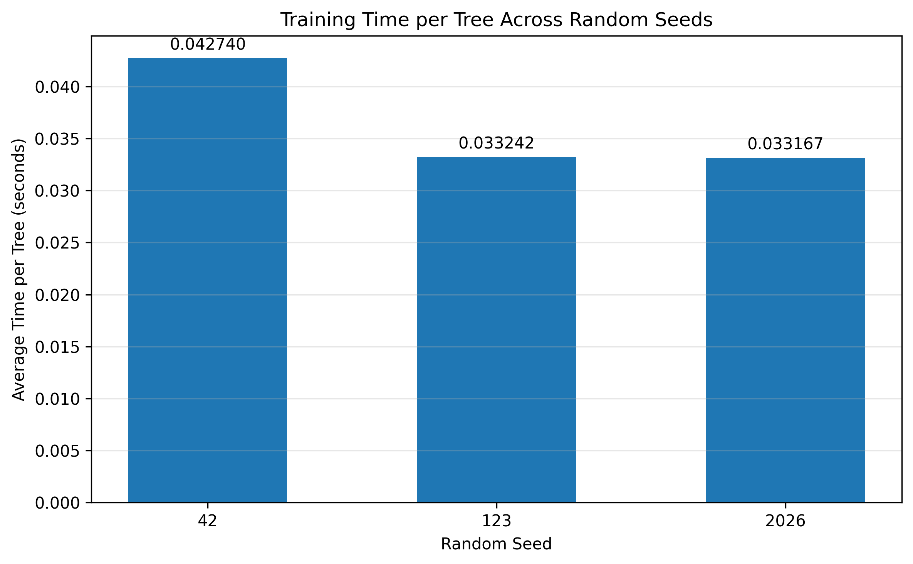

# Preliminary Experimental Results Analysis

## 1. Objective

This report presents a preliminary statistical analysis of the initial XGBoost experiments conducted on the HIGGS-1M dataset.

The purpose is to evaluate the initial classification performance and training efficiency of XGBoost across three recorded random seeds.

The analysis is part of the experimental results analysis workstream of the XGBoost paper replication project.

## 2. Experimental Configuration

The current preliminary experiments use the following configuration:

| Parameter | Value |
|---|---|
| Model | XGBoost |
| Dataset | HIGGS-1M |
| Task | Binary Classification |
| Number of Boosting Rounds | 500 |
| Maximum Tree Depth | 8 |
| Learning Rate | 0.1 |
| Random Seeds | 42, 123, 2026 |
| Evaluation Metric | Test AUC |

## 3. Preliminary Experimental Results

The following results were collected from the three CSV files uploaded to the project repository.

| Random Seed | Test AUC | Time per Tree (s) |
|---|---:|---:|
| 42 | 0.822777 | 0.042740 |
| 123 | 0.822305 | 0.033242 |
| 2026 | 0.822177 | 0.033167 |

### 3.1 Statistical Summary

The mean and sample standard deviation were calculated across the three recorded results.

| Metric | Mean | Standard Deviation |
|---|---:|---:|
| Test AUC | 0.822420 | 0.000316 |
| Time per Tree (s) | 0.036383 | 0.005505 |

The estimated mean total training time is approximately 18.1915 seconds, calculated by multiplying the mean time per tree by 500 boosting rounds.

This is an estimate rather than an independently recorded total training time.

## 3.2 Experimental Visualizations

### Figure 1. Test AUC Across Random Seeds

The figure illustrates the Test AUC values obtained from three different random seeds. The results show relatively small variation in classification performance.

### Figure 2. Training Time per Tree Across Random Seeds

The figure compares the average training time per tree across the three recorded random seeds. Seed 42 shows a higher training time per tree than the other two runs.

## 4. Preliminary Analysis

### 4.1 Classification Performance

The three recorded Test AUC values are close to each other, with a mean of approximately 0.822420.

The sample standard deviation is approximately 0.000316, indicating relatively small variation in the recorded AUC values.

### 4.2 Training Efficiency

The mean time per tree is approximately 0.036383 seconds.

However, the result for random seed 42 has a noticeably higher training time per tree than the other two records.

This difference should be investigated in subsequent experiments, particularly with respect to the execution environment and experimental reproducibility.

### 4.3 Preliminary Observations

The current results provide an initial reference for evaluating XGBoost performance.

However, they are not sufficient to establish the final reproducibility of the original paper's experimental results.

## 5. Data Quality and Reproducibility Limitations

Several issues require further verification:

1. The committed training script currently uses a fixed random seed, which needs to be made configurable.
2. The current feature selection uses 27 features instead of the expected 28 features.
3. The log associated with random seed 42 requires correction and verification.
4. The three recorded experiment results need to be reproduced using a consistent and verified training pipeline.
5. The hardware and software environment should be documented for a fair interpretation of training efficiency.

Therefore, all results in this report should be treated as preliminary rather than final validated experimental findings.

## 6. Next Steps

The following tasks are recommended:

- Verify the training process for all three random seeds.
- Correct the feature selection and confirm the number of input features.
- Record actual training time and model configuration consistently.
- Complete the scikit-learn baseline experiments.
- Compare the validated results with the corresponding results in the original XGBoost paper.
- Conduct the planned maximum tree depth sensitivity experiments.

## 7. Conclusion

The preliminary analysis establishes an initial statistical reference for the XGBoost experiments.

The recorded mean Test AUC is 0.822420, with a sample standard deviation of 0.000316.

Further verification and additional experiments are necessary before drawing final conclusions about the reproduction of the original paper.