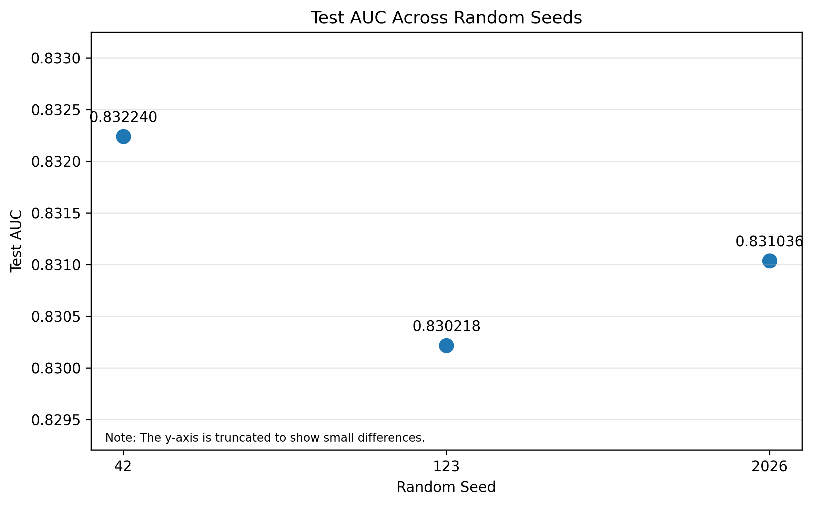

# Preliminary Experimental Results Analysis

## 1. Objective

This report presents a preliminary statistical analysis of the initial XGBoost experiments conducted on the HIGGS-1M dataset.

The purpose is to evaluate the initial classification performance and training efficiency of XGBoost across three recorded random seeds.

The analysis is part of the experimental results analysis workstream of the XGBoost paper replication project.

## 2. Experimental Configuration

The current preliminary experiments use the following configuration:

| Parameter | Value |
|---|---|
| Model | XGBoost |
| Dataset | HIGGS-1M |
| Task | Binary Classification |
| Number of Boosting Rounds | 500 |
| Maximum Tree Depth | 8 |
| Learning Rate | 0.1 |
| Random Seeds | 42, 123, 2026 |
| Evaluation Metric | Test AUC |

## 3. Updated Preliminary Experimental Results

The following results were obtained from the
latest XGBoost experiment records for three
random seeds: 42, 123, and 2026.

The original per-seed CSV files were produced
by the model training workstream.

The analysis input was synchronized using
scripts/sync_analysis_data.py.

| Seed | Test AUC | Time per Tree (s) |
|---|---:|---:|
| 42 | 0.832240 | 0.135046 |
| 123 | 0.830218 | 0.137869 |
| 2026 | 0.831036 | 0.147877 |

### 3.1 Statistical Summary

The mean and sample standard deviation were
calculated across the three experiment records.

| Metric | Mean | Sample Std |
|---|---:|---:|
| Test AUC | 0.831164 | 0.001017 |
| Time per Tree (s) | 0.140264 | 0.006742 |
| Derived Total Training Time (s) | 70.1318 | 3.3712 |

Total training time was derived by multiplying
the reported time per tree by 500 rounds.

It was not independently measured by the
analysis pipeline.

The statistical results were generated using
scripts/analyze_results.py.

### 3.2 Cross-Seed Stability Analysis

To further evaluate the stability of the preliminary
XGBoost results, the variation across the three
random seeds was examined.

The coefficient of variation (CV) was calculated
as the sample standard deviation divided by
the corresponding mean.

| Metric | Mean | Sample Std | Range | CV |
|---|---:|---:|---:|---:|
| Test AUC | 0.831164 | 0.001017 | 0.002022 | 0.122% |
| Time per Tree (s) | 0.140264 | 0.006742 | 0.012831 | 4.807% |

The Test AUC shows relatively low variation
across the three recorded random seeds.
This suggests that the preliminary classification
performance is relatively stable under the
current experimental configuration.

In contrast, training time per tree exhibits
greater relative variation.

Seed 42 achieved both the highest Test AUC
and the lowest recorded training time per tree.
Seed 2026 had the highest training time,
but did not achieve the highest Test AUC.

Therefore, the three recorded runs do not
show a consistent relationship between
training time and classification performance.

However, only three random seeds are available.
These observations are descriptive and
should not be interpreted as statistical evidence
of a general relationship.

The training-time records are based on the
existing experiment outputs. The reported
total training time in the analysis input
is derived from time per tree multiplied
by 500 boosting rounds, rather than being
an independent timing measurement.

### 3.3 Experimental Interpretation

The current results indicate that XGBoost
achieves relatively consistent classification
performance across the three recorded seeds.

The variation in training time is larger
than the variation in Test AUC.

Further experiments with additional random
seeds would help determine whether the
observed timing variation is systematic
or caused by run-to-run execution differences.

### 3.4 Experimental Visualizations

#### Figure 1. Test AUC Across Random Seeds

The figure shows relatively small variation in
Test AUC across the three recorded seeds.

The vertical axis is truncated to make small
differences easier to visualize.

#### Figure 2. Training Time per Tree

The training time per tree varies across runs.

Seed 2026 has the highest recorded time per tree,
while seed 42 has the lowest.

These differences require further investigation
before their causes can be determined.

## 4. Comparison with the Original Paper

The original XGBoost paper reports a Test AUC
of 0.8304 for XGBoost in Table 3.

Our preliminary mean Test AUC is 0.831164.

The absolute difference is approximately:

0.831164 - 0.8304 = +0.000764

The result is numerically close to the
original paper's reported value.

However, this does not establish an exact
reproduction because the experimental
conditions are not fully aligned.

Potential sources of discrepancy include:

- Dataset subset selection.
- Training, validation and test splitting.
- Software and library versions.
- Hardware configuration.
- Tree construction methods.
- Training-time measurement protocols.

The original paper's absolute training time
cannot be directly compared with our current
measurements without accounting for these
differences.

The scikit-learn baseline is not yet available,
so the full performance and efficiency
comparison remains incomplete.

## 5. Reproducibility Assessment

The existing experimental output files were
checked using scripts/validate_results.py.

All three seeds passed the file-consistency
checks.

The validator checks the consistency of:

- Experimental result CSV files.
- Recorded random seeds.
- AUC and timing values.
- Boosting-round records.
- Training and validation AUC curves.
- Training logs.

However, passing these checks does not
demonstrate independent experimental
reproducibility.

The latest training implementation uses
all 28 input features.

The earlier 27-feature problem has been
corrected.

Remaining limitations include:

1. The committed training script still uses
   a fixed random seed value.

2. The XGBoost tree construction method
   is not explicitly configured.

3. Hardware and software information
   is not fully documented.

4. The scikit-learn baseline has not
   been completed.

5. Independent controlled reruns are
   still required.

Therefore, these results should be treated as preliminary rather than final evidence
of successful paper reproduction.

## 6. Next Steps

The remaining work includes:

1. Make random seeds configurable in the
   training script.

2. Complete the scikit-learn baseline under
   comparable experimental conditions.

3. Verify library versions and hardware
   configurations.

4. Align the training and evaluation protocols.

5. Conduct the maximum tree depth extension
   using depths 4, 6, 8 and 10.

6. Generate the final Paper vs. Ours comparison.

7. Prepare the final experimental analysis
   and reproducibility conclusions.

## 7. Conclusion

The updated preliminary experiments produced
a mean Test AUC of 0.831164 with a sample
standard deviation of 0.001017.

The mean time per tree was 0.140264 seconds,
with a sample standard deviation of 0.006742.

The mean Test AUC is numerically close
to the value reported in the original paper.

However, additional controlled experiments
are required before the main reproduction
claims can be fully evaluated.

This analysis provides an updated reference
for subsequent model comparison and
extension experiments.

## 8. Contribution and Integration Notes

The original statistical analysis framework,
visualization scripts and preliminary report
were developed by ZHANG YU (2260032265).

The updated analysis integration was carried
out by Xinyi Zhang (2260031561).

The integration work includes:

- Developing an automated data synchronization
  script for the latest XGBoost results.
- Extending statistical analysis to include
  training-time standard deviations.
- Improving input data validation.
- Regenerating statistical summaries and figures.
- Updating the preliminary analysis and
  reproducibility limitations.

The original contribution history is preserved
through Git commits and the integration branch.

The training results used in this analysis
originate from the model implementation
workstream and are not claimed as newly
generated training runs.

