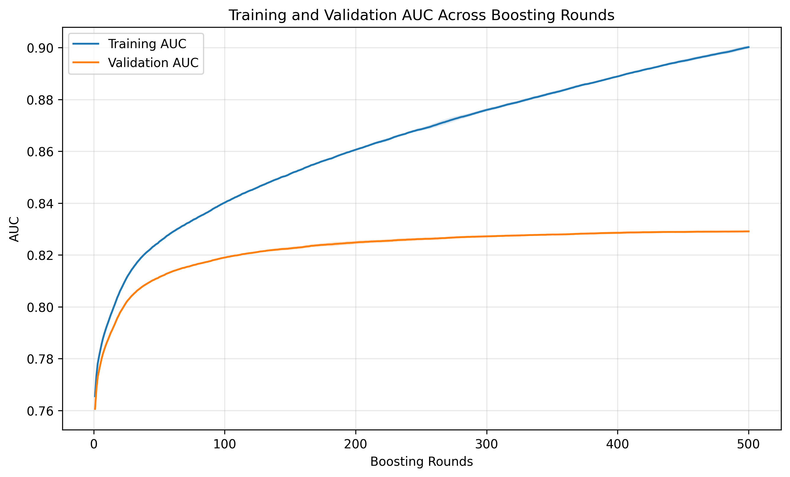

# Preliminary Experimental Results Analysis

## 1. Objective

This report presents a preliminary statistical analysis of the initial XGBoost experiments conducted on the HIGGS-1M dataset.

The purpose is to evaluate the initial classification performance and training efficiency of XGBoost across three recorded random seeds.

The analysis is part of the experimental results analysis workstream of the XGBoost paper replication project.

## 2. Experimental Configuration

The current preliminary experiments use the following configuration:

| Parameter | Value |
|---|---|
| Model | XGBoost |
| Dataset | HIGGS-1M |
| Task | Binary Classification |
| Number of Boosting Rounds | 500 |
| Maximum Tree Depth | 8 |
| Learning Rate | 0.1 |
| Random Seeds | 42, 123, 2026 |
| Evaluation Metric | Test AUC |

## 3. Updated Preliminary Experimental Results

The following results were obtained from the
latest XGBoost experiment records for three
random seeds: 42, 123, and 2026.

The original per-seed CSV files were produced
by the model training workstream.

The analysis input was synchronized using
scripts/sync_analysis_data.py.

| Seed | Test AUC | Time per Tree (s) |
|---|---:|---:|
| 42 | 0.832240 | 0.135046 |
| 123 | 0.830218 | 0.137869 |
| 2026 | 0.831036 | 0.147877 |

### 3.1 Statistical Summary

The mean and sample standard deviation were
calculated across the three experiment records.

| Metric | Mean | Sample Std |
|---|---:|---:|
| Test AUC | 0.831164 | 0.001017 |
| Time per Tree (s) | 0.140264 | 0.006742 |
| Derived Total Training Time (s) | 70.1318 | 3.3712 |

Total training time was derived by multiplying
the reported time per tree by 500 rounds.

It was not independently measured by the
analysis pipeline.

The statistical results were generated using
scripts/analyze_results.py.

### 3.2 Cross-Seed Stability Analysis

To further evaluate the stability of the preliminary
XGBoost results, the variation across the three
random seeds was examined.

The coefficient of variation (CV) was calculated
as the sample standard deviation divided by
the corresponding mean.

| Metric | Mean | Sample Std | Range | CV |
|---|---:|---:|---:|---:|
| Test AUC | 0.831164 | 0.001017 | 0.002022 | 0.122% |
| Time per Tree (s) | 0.140264 | 0.006742 | 0.012831 | 4.807% |

The Test AUC shows relatively low variation
across the three recorded random seeds.
This suggests that the preliminary classification
performance is relatively stable under the
current experimental configuration.

In contrast, training time per tree exhibits
greater relative variation.

Seed 42 achieved both the highest Test AUC
and the lowest recorded training time per tree.
Seed 2026 had the highest training time,
but did not achieve the highest Test AUC.

Therefore, the three recorded runs do not
show a consistent relationship between
training time and classification performance.

However, only three random seeds are available.
These observations are descriptive and
should not be interpreted as statistical evidence
of a general relationship.

The training-time records are based on the
existing experiment outputs. The reported
total training time in the analysis input
is derived from time per tree multiplied
by 500 boosting rounds, rather than being
an independent timing measurement.

### 3.3 Experimental Interpretation

The current results indicate that XGBoost
achieves relatively consistent classification
performance across the three recorded seeds.

The variation in training time is larger
than the variation in Test AUC.

Further experiments with additional random
seeds would help determine whether the
observed timing variation is systematic
or caused by run-to-run execution differences.

### 3.4 Learning Curve Analysis

To further investigate the learning behavior of XGBoost, the training and validation AUC curves were analyzed across 500 boosting rounds.

The analysis uses the recorded training and validation AUC values from three random seeds: 42, 123 and 2026. The mean AUC and sample standard deviation were calculated at each boosting round.

The following table summarizes the learning process at selected checkpoints.

| Boosting Rounds | Mean Training AUC | Mean Validation AUC | AUC Gap |
|---:|---:|---:|---:|
| 1 | 0.765524 | 0.760634 | 0.004890 |
| 100 | 0.840193 | 0.819010 | 0.021183 |
| 250 | 0.868492 | 0.826143 | 0.042350 |
| 500 | 0.900167 | 0.829102 | 0.071066 |

The AUC gap is calculated as the difference between training AUC and validation AUC.

**Figure 3. Training and Validation AUC Across Boosting Rounds**

The learning curves reveal three main observations.

First, both training and validation AUC increase rapidly during the initial boosting rounds, indicating that the model learns useful classification patterns early in training.

Second, validation AUC gradually approaches a plateau, while training AUC continues to increase. This indicates diminishing improvements in validation performance as more boosting rounds are added.

Third, the gap between training and validation AUC increases from 0.004890 at the first boosting round to 0.071066 at the 500th round. This suggests an increasing degree of overfitting tendency as training progresses.

However, validation AUC does not show a substantial decline during the experiment. Therefore, the results do not provide sufficient evidence to conclude that severe overfitting has occurred.

Overall, increasing the number of boosting rounds improves training performance, but the corresponding gains in validation performance become progressively smaller. This suggests that further increases in training iterations may provide limited generalization benefits under the current experimental configuration.

The shaded regions represent one sample standard deviation across the three random seeds.

### 3.5 Experimental Visualizations

#### Figure 1. Test AUC Across Random Seeds

The figure shows relatively small variation in
Test AUC across the three recorded seeds.

The vertical axis is truncated to make small
differences easier to visualize.

#### Figure 2. Training Time per Tree

The training time per tree varies across runs.

Seed 2026 has the highest recorded time per tree,
while seed 42 has the lowest.

These differences require further investigation
before their causes can be determined.

#### Figure 3. Training and Validation AUC Across Boosting Rounds

The figure presents the mean training and validation
AUC across three random seeds.

Training AUC continues to increase throughout
the boosting process, while validation AUC
shows progressively smaller improvements.

### 3.6 Learning Curve and Generalization Gap Analysis

To investigate the model's learning behavior,
the training and validation AUC curves were
analyzed across 500 boosting rounds.

The following table summarizes the mean AUC
at selected boosting rounds across three seeds.

| Boosting Rounds | Mean Training AUC | Mean Validation AUC | Generalization Gap |
|---:|---:|---:|---:|
| 50 | 0.825114 | 0.811469 | 0.013646 |
| 100 | 0.840193 | 0.819010 | 0.021183 |
| 200 | 0.860590 | 0.824840 | 0.035750 |
| 300 | 0.875955 | 0.827185 | 0.048770 |
| 400 | 0.888861 | 0.828551 | 0.060309 |
| 500 | 0.900167 | 0.829102 | 0.071066 |

The results show that training AUC increases
continuously as the number of boosting rounds grows.

However, validation AUC improves more slowly.
Between rounds 400 and 500, mean validation AUC
increases by only approximately 0.000550,
while training AUC increases by 0.011307.

The generalization gap also increases from
0.013646 at round 50 to 0.071066 at round 500.

This indicates that the model continues to fit
the training data increasingly well, while
improvements in validation performance become
limited.

The growing generalization gap suggests a
potential overfitting tendency.

However, validation AUC does not show a
substantial decline during the final boosting
rounds. Therefore, the current evidence does
not establish severe overfitting.

Further experiments with different maximum
tree depths and boosting rounds are needed
to investigate this behavior.

The validation AUC curves are used here
to analyze learning behavior. They should
not be confused with the final Test AUC
reported in the main experimental results.

## 4. Comparison with the Original Paper

### 4.1 Quantitative Comparison

The preliminary XGBoost results were compared
with the reference results reported in Table 3
of the original paper.

| Method | Paper Test AUC | Our Test AUC | Paper Time per Tree (s) | Our Time per Tree (s) |
|---|---:|---:|---:|---:|
| XGBoost | 0.8304 | 0.831164 ± 0.001017 | 0.6841 | 0.140264 ± 0.006742 |
| scikit-learn | 0.8302 | Pending | 28.51 | Pending |

The XGBoost results are averaged across
three random seeds: 42, 123 and 2026.

The scikit-learn baseline has not yet been
completed, so its experimental results
are currently unavailable.

### 4.2 Performance Difference Analysis

The mean Test AUC obtained by our XGBoost
implementation is 0.831164, compared with
0.8304 reported in the original paper.

The absolute difference is:

0.831164 - 0.8304 = 0.000764

This indicates that our preliminary
classification performance is numerically
close to the original paper's result.

In terms of training efficiency, our mean
time per tree is 0.140264 seconds, compared
with 0.6841 seconds in the original paper.

Numerically, our measured time per tree
is approximately 4.88 times shorter.

However, this difference should not be
interpreted as a direct speedup achieved
by our implementation.

The original paper and our experiments
may differ in hardware, software versions,
dataset selection, tree construction methods
and timing protocols.

In particular, our current training
implementation includes training and
validation AUC evaluation during each
boosting round.

These differences prevent a fully controlled
comparison of absolute training efficiency.

### 4.3 Reproduction Limitations

Although the preliminary XGBoost Test AUC
is close to the original paper's reported
value, several experimental differences
remain.

1. **Dataset selection:** Our implementation
   uses the first 1,000,000 rows of the HIGGS
   dataset rather than the randomly selected
   subset described in the paper.

2. **Data splitting:** Our implementation
   uses a 70/15/15 training, validation
   and test split.

3. **Tree construction:** The current
   implementation does not explicitly
   configure the tree construction method
   used in the original experiment.

4. **Computational environment:** Hardware
   and software environments differ and
   require further documentation.

5. **Baseline comparison:** The scikit-learn
   baseline has not yet been completed.

Therefore, the current results demonstrate
numerical agreement in preliminary
classification performance, but do not
establish an exact reproduction of the
original experiment.

A complete evaluation of the original
performance and efficiency claims requires
the scikit-learn baseline and further
controlled experiments.

## 5. Reproducibility Assessment

### 5.1 Result File Validation

The existing experimental outputs were checked
using scripts/validate_results.py.

All three recorded experiment sets passed
the file-consistency validation.

The validation process checks:

- Required experimental result files.
- Consistency between CSV seed labels and filenames.
- Validity of Test AUC and training-time values.
- Completeness of the 500 boosting rounds.
- Consistency between training logs and AUC curves.
- Agreement between logged and recorded final metrics.

The three recorded experiments contain
different training curves and final results.

This indicates that the records are not
identical copies of the same experimental output.

### 5.2 Random Seed Verification

Although the result files are labelled
with random seeds 42, 123 and 2026,
the training logs do not explicitly record
the random seed used during execution.

Furthermore, the current training script
contains a hard-coded seed value of 123.

Consequently, the validation script can
verify the consistency of the recorded files,
but cannot independently verify the actual
random seed used in each historical run.

The exact correspondence between the
recorded seed labels and the original
execution configurations therefore remains
to be confirmed.

### 5.3 Remaining Reproducibility Limitations

The following limitations remain:

1. Historical random seed configurations
   require confirmation.

2. Random seed configuration should be
   made adjustable through command-line
   arguments or an experiment loop.

3. The actual random seed should be
   explicitly recorded in each training log.

4. The XGBoost tree construction method
   requires explicit configuration.

5. Hardware and software environments
   require more complete documentation.

6. Independent experimental reruns
   are still required.

Passing file-consistency validation does
not establish independent reproducibility.

Therefore, the current results should
remain classified as preliminary evidence
until the experimental configurations
can be independently verified.

## 6. Next Steps

The remaining work includes:

1. Make random seeds configurable in the
   training script.

2. Complete the scikit-learn baseline under
   comparable experimental conditions.

3. Verify library versions and hardware
   configurations.

4. Align the training and evaluation protocols.

5. Conduct the maximum tree depth extension
   using depths 4, 6, 8 and 10.

6. Generate the final Paper vs. Ours comparison.

7. Prepare the final experimental analysis
   and reproducibility conclusions.

## 7. Conclusion

The updated preliminary experiments produced
a mean Test AUC of 0.831164 with a sample
standard deviation of 0.001017.

The mean time per tree was 0.140264 seconds,
with a sample standard deviation of 0.006742.

The mean Test AUC is numerically close
to the value reported in the original paper.

However, additional controlled experiments
are required before the main reproduction
claims can be fully evaluated.

This analysis provides an updated reference
for subsequent model comparison and
extension experiments.

## 8. Contribution and Integration Notes

The original statistical analysis framework,
visualization scripts and preliminary report
were developed by ZHANG YU (2260032265).

The updated analysis integration was carried
out by Xinyi Zhang (2260031561).

The integration work includes:

- Developing an automated data synchronization
  script for the latest XGBoost results.
- Extending statistical analysis to include
  training-time standard deviations.
- Improving input data validation.
- Regenerating statistical summaries and figures.
- Updating the preliminary analysis and
  reproducibility limitations.

The original contribution history is preserved
through Git commits and the integration branch.

The training results used in this analysis
originate from the model implementation
workstream and are not claimed as newly
generated training runs.

